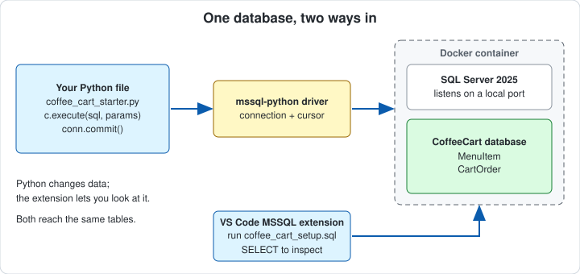
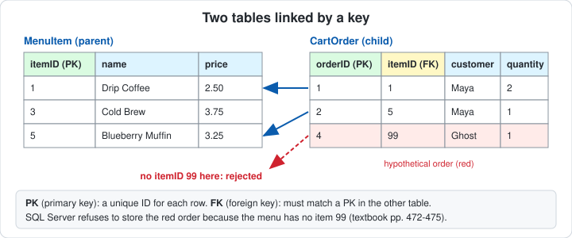
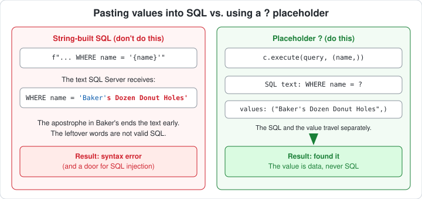
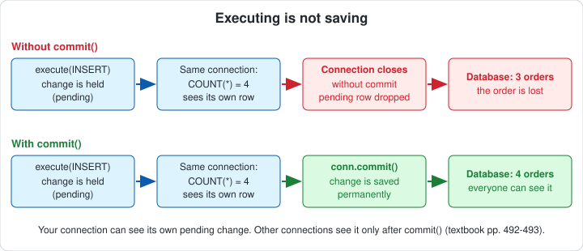

# Student Guide: The Coffee Cart Ledger

## What you're doing

A campus coffee cart tracks its menu and customer orders in a database. You'll finish four small functions, and before each experiment you'll **predict** what will happen (write it on paper or say it aloud). Then you'll run it and explain the result.

Keep the textbook handy: Chapter 17, pages 470–475, 478–479, and 486–494.



## Professional skills you're building

- Reading and writing SQL from inside Python
- Passing values to a database safely
- Understanding when a change is actually saved
- Using relationships between tables to keep data consistent

These apply to any analytics or business application that stores transactions.

## Three ideas in plain language

**1. Tables are linked by keys (pp. 470–475).**
`MenuItem` and `CartOrder` are two tables. Each menu item has a unique `itemID` (its *primary key*). Each order stores an `itemID` too, and that column is a *foreign key*: it must match a real menu item. Think of it as the order saying "I'm about item #2" and the database checking that item #2 exists.



**2. Placeholders carry values into SQL (pp. 488–489, 492–493).**
Instead of pasting values into the SQL text, you write `?` where a value goes and hand the values to `execute()` separately in a tuple:

```python
c.execute("SELECT name FROM dbo.MenuItem WHERE itemID = ?", (3,))
```

The database treats the value as *data*, never as part of the SQL command. A tuple with one value needs a trailing comma: `(3,)`.



**3. Executing is not saving (pp. 492–493).**
After an `INSERT`, `UPDATE`, or `DELETE`, your connection holds the change in a pending transaction. `conn.commit()` makes it permanent. Without it, closing the connection throws the change away.



## SQL Server vs. the textbook's SQLite

Same ideas, different engine. SQL Server runs as a separate service (in Docker here), so you connect with an address and password instead of a file path. It also enforces foreign keys, while the textbook notes SQLite doesn't raise an error for an invalid one (p. 494). Full comparison table is in `README.md`.

## Setup check

1. Open **File → Open Folder… → `Chapter_17_Activity`** in VS Code. The **Python** and **SQL Server (mssql)** extensions are installed.
2. Docker Desktop is open and your SQL Server container is running (password `CoffeeCart#2026`).
3. Open `code/coffee_cart_starter.py`. Press **Cmd+Shift+P** on Mac or **Ctrl+Shift+P** on Windows, choose **Python: Select Interpreter**, and select the activity's **`.venv`**, where `requirements.txt` was installed. See the README's **Setup** section if needed.
4. Click `coffee_cart_setup.sql` in the Explorer, connect to your container, clear any text selection, and click **Execute** (play icon, top right). Shortcut: **Cmd+Shift+E** on Mac or **Ctrl+Shift+E** on Windows. Results appear in the SQL results panel. Refresh **CoffeeCart → Tables** in the SQL Server sidebar.
5. Expand `code`, click `coffee_cart_starter.py`, save, and click **▶ Run Python File** at the top right. If there is a dropdown, choose **Run Python File in Terminal**. Stage 0 prints in the bottom **Terminal** panel.

**Checkpoint 0:** You see six menu items and "Orders on file: 3."

Finish the current run before clicking the run button again. You can launch both files with buttons; the Python output appears in the Terminal panel.

The SQL setup is useful for inspecting the tables but is optional for Python to start: the starter runs it automatically. Keep the SQL file in the main folder and the Python file in `code/`. The starter finds the SQL file relative to itself, regardless of the terminal's working folder.

## Warm-up in SQL (2 minutes, before any Python)

In the SQL Server sidebar, open a **new query on CoffeeCart**, enter the following statements, and click **Execute**:

```sql
SELECT * FROM dbo.MenuItem;
SELECT * FROM dbo.CartOrder;
```

You'll write the same kinds of statements from Python in a moment. Notice the `itemID` column in both tables.

## Key terms (read these before the tasks)

You'll see these words in the starter code and the hints. You don't need to memorize them; come back to this table when one is unfamiliar.

| Term | What it means | Where you'll see it |
|---|---|---|
| **Table, row, column** | A table is like a spreadsheet tab. A row is one record (one drink, one order). A column is one attribute (name, price). | `MenuItem`, `CartOrder` |
| **`dbo.`** | The default "folder" SQL Server puts tables in. Write `dbo.MenuItem`, not just `MenuItem`, in your SQL. | `FROM dbo.MenuItem` |
| **`SELECT`, `INSERT`, `JOIN`** | `SELECT` reads rows. `INSERT` adds a row. `JOIN` combines two tables using a matching column. `WHERE` filters the rows. | TODOs 1, 2, 4 |
| **Connection (`conn`)** | The open link between Python and SQL Server, like a phone call. It is already opened for you. | `conn` parameter |
| **Cursor (`c`)** | The object you use to send SQL and read results back, like the person talking on the call. You get one with `conn.cursor()`. | `c = conn.cursor()` |
| **`execute(sql, values)`** | Sends one SQL statement to the database. The second argument supplies the values for the `?` placeholders. | `c.execute(...)` |
| **Placeholder `?`** | A blank in the SQL that gets filled by a value you pass separately, like Mad Libs for SQL. | `WHERE name = ?` |
| **Tuple** | Values in parentheses, in order: `(item_id, customer, quantity)`. A one-value tuple needs a trailing comma: `(name,)`. | second argument of `execute()` |
| **Result set** | The rows a `SELECT` sends back. `fetchone()` gets the next row; `fetchall()` gets all of them. | starter helpers |
| **`fetch_one_dict`, `fetch_all_dicts`** | Supplied helpers that turn rows into dictionaries so you can write `item['name']`. You just call them. | `return fetch_one_dict(c)` |
| **Transaction** | A group of changes held together until they are saved or dropped, like a shopping cart: nothing is bought until checkout. | Idea 3 |
| **`commit()`** | Checkout: makes the held changes permanent. You call it on the **connection** (`conn.commit()`), not the cursor. | TODO 3 |
| **`with closing(...) as c:`** | Opens the cursor for the indented block and automatically closes it when the block ends, even if an error happens. | every function |
| **`query` / `sql`** | Just variable names for the SQL text. Any name works; the textbook uses `query` for reads and `sql` for changes. Triple quotes (`'''...'''`) let the SQL span several lines. | your TODO code |
| **Docker container** | SQL Server running in a sealed box on your laptop. | Docker Desktop |

### The pattern every TODO follows

```python
with closing(conn.cursor()) as c:      # 1. get a cursor (it closes itself afterward)
    c.execute(sql, (value1, value2))   # 2. send the SQL, with the values in a tuple
    row = c.fetchone()                 # 3. SELECT only: read the result
conn.commit()                          # 4. INSERT/UPDATE/DELETE only: save the change
```

A SELECT uses steps 1 to 3. An INSERT uses steps 1, 2, and 4. Notice that `commit()` is outside the `with` block and belongs to `conn`.

## Tasks

Work in the **STUDENT ZONE** of `code/coffee_cart_starter.py`, in order. **Save and click Run Python File after each task.** Before each Run, write your prediction on paper or say it aloud. The program prints a `>>> QUESTION:` line for each stage, and that question is what you are predicting. The database resets itself on every run.

### Task 1: Look up an item (TODO 1)

Finish `find_item_by_name(conn, name)`.

*Hints:*
- Use `with closing(conn.cursor()) as c:` like the textbook (p. 489).
- Your SQL needs a `?` where the name goes: `WHERE name = ?`
- Pass `(name,)` as the second argument to `execute()`.
- `return fetch_one_dict(c)`

**Predict first:** Stage 1 looks up "Cold Brew" and "Baker's Dozen Donut Holes," each with string-built SQL and with your placeholder version. Which lookups will fail?

**Checkpoint 1:** Your placeholder version finds both items. Can you explain why the string-built version fails on only one? (Look at the apostrophe in `Baker's`.)

### Task 2: Place an order (TODO 2)

In `place_order(conn, item_id, customer, quantity)`, write an `INSERT` with three `?` placeholders and execute it with a three-value tuple. **Don't commit yet.**

*Hints:*
- Column order: `INSERT INTO dbo.CartOrder (itemID, customer, quantity) VALUES (?, ?, ?)`
- Model it on the textbook's INSERT on p. 493.

**Predict first:** Stage 2 counts orders before the insert, right after it, and after closing and reconnecting. Write down your three numbers.

**Checkpoint 2:** Run it. Do your three counts match what you predicted? If the third count surprised you, good. Hold that thought for Task 3.

### Task 3: Save it (TODO 3)

Add **one line** to `place_order()` so the change is saved. Save and click **Run Python File** again.

**Checkpoint 3:** The third count now matches the second. In your own words: what did that one line change, and why did the "right after" count look correct even before you added it?

### Optional: see it in SQL

Want to watch "executing is not saving" without Python? Open `coffee_cart_commit_demo.sql` and click **Execute**: the counts are 3, 4, 3 (the change is rolled back). Change `ROLLBACK` to `COMMIT` and run again: 3, 4, 4. It creates no tables. Run `coffee_cart_setup.sql` afterward to reset.

### Stage 3 (no code): The missing item

Stage 3 tries to order item 99, but the menu only has items 1 to 6. **Predict first:** what will SQL Server do? Then check the Stage 3 output.

**Checkpoint 4:** What did SQL Server do? Which column caused the problem, and which table does it point to? How does this differ from the textbook's note about SQLite on p. 494?

### Task 4: Print a receipt (TODO 4)

Finish `get_receipt(conn, customer)`. It should `JOIN` `CartOrder` to `MenuItem` and return `name`, `price`, and `quantity` for one customer.

*Hints:*
- The join is on `itemID`. Follow the example on p. 479.
- Both tables have an `itemID` column, so write `CartOrder.itemID = MenuItem.itemID` in the `ON` clause.
- Select `MenuItem.name, MenuItem.price, CartOrder.quantity`.
- Filter with `WHERE CartOrder.customer = ?` and pass `(customer,)`.
- `return fetch_all_dicts(c)`

**Checkpoint 5:** Maya's total is **$8.25** and Priya's is **$9.50**.

### Final check in VS Code

After the completed Python run finishes, open a **new query on CoffeeCart** in the SQL Server sidebar. Enter the following and click **Execute**:

```sql
SELECT * FROM dbo.CartOrder;
```

You should see four rows, including Priya's order. The database confirms what Python did. Use this new query for inspection: executing `coffee_cart_setup.sql` again would reset the tables to the original three orders.

## Common mistakes

| Symptom | Likely cause | Fix |
|---|---|---|
| Stage 2 shows `3, 4, 3` | No `commit()` | Add `conn.commit()` after `execute()` (TODO 3) |
| "Wrong number of parameters" error | Placeholder count doesn't match tuple length | Count the `?` marks and the tuple items |
| Error with a single value like `(name)` | Missing trailing comma | Write `(name,)` |
| A name with an apostrophe breaks your query | Value pasted into SQL text | Use `?` placeholders |
| Script hangs | A different connection is waiting on uncommitted rows | Stop it with Ctrl+C and rerun; commit or close before opening a second connection |
| `No module named 'mssql_python'` | VS Code is running a Python without the driver | Use **Python: Select Interpreter** to select `.venv`. If the driver is missing there, follow the README's requirements installation step. |
| Clicking Run again does not start a new run | The previous run is still going | Wait for it to finish, or press Ctrl+C in the terminal, then click Run again |
| "Can't find coffee_cart_setup.sql" | Files are outside the supplied layout | Keep the SQL file in `Chapter_17_Activity/` and the Python file in `code/`. Changing the terminal folder will not fix a misplaced file. |
| SQL setup runs only part of the file | Text was selected | Clear the selection, then click **Execute** |
| Final check shows three orders | SQL setup was executed again after Python | Rerun the completed Python file, then inspect with a **new query** |
| Can't connect; "host not found" | Container uses a port other than 1433, or `localhost` didn't resolve | The starter tries ports 1433-1436. If yours differs, read it in Docker Desktop (`<host>:1433`) and set `MSSQL_SERVER=127.0.0.1,<host>` in `.env` |
| Can't connect | Container stopped, different password, or different port | Check Docker Desktop; if you used another password or port, set it in `.env` |

## Stretch goals

- Write `cancel_order(conn, order_id)` with a `DELETE ... WHERE orderID = ?` and commit it (textbook p. 480–481). Be careful with the `WHERE` clause.
- Add a `quantity` check so `place_order()` refuses quantities below 1.
- Write `get_customer_total(conn, customer)` that does the arithmetic in SQL with `SUM(price * quantity)` and compare it with the Python total.

## Reflection (answer in a sentence or two each)

1. What is the difference between *executing* an INSERT and *committing* it?
2. Why is `WHERE name = ?` with a tuple safer than building the SQL with an f-string?
3. What does the foreign key protect against? Name a case from a real business where that matters.
4. Where in an analytics or business program could you use these three ideas?

## Using AI well

Good uses: "Explain what a foreign key is," or "What does this error message mean?" Try the TODOs yourself first. The goal is for *you* to understand what the code does to the database.
